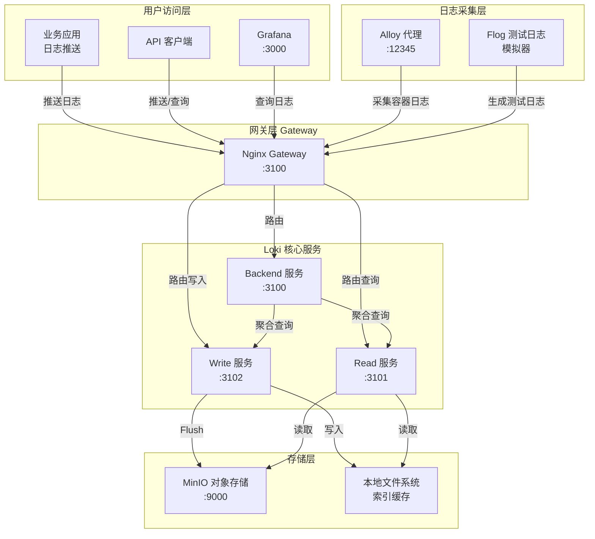
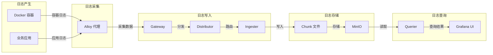
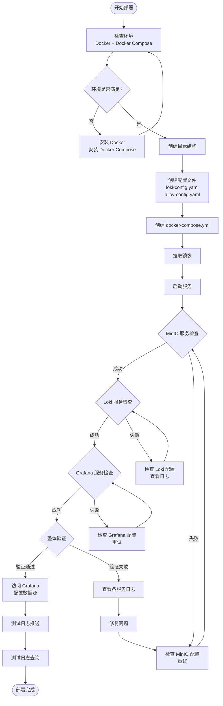
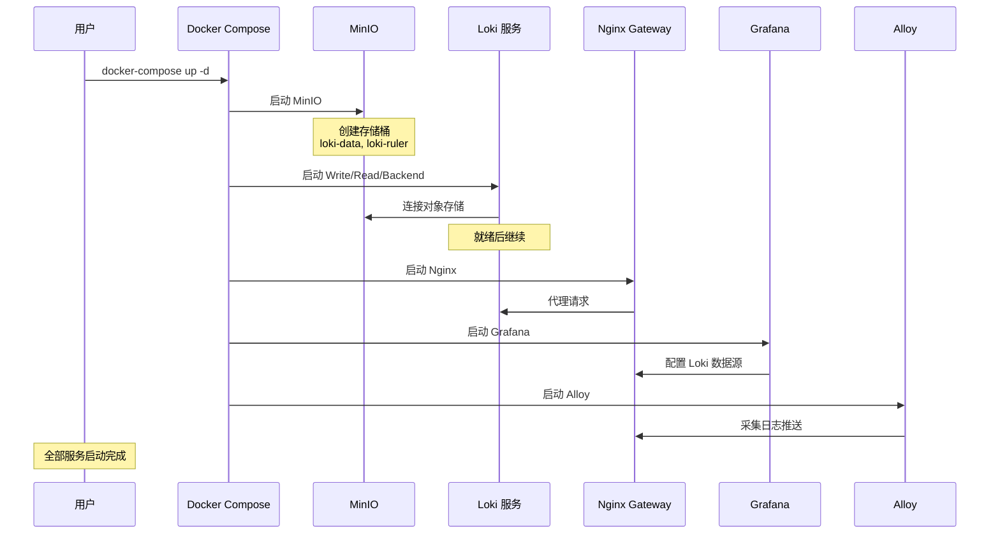

## 文档信息
| 项目 | 内容 |
| --- | --- |
| 版本 | v1.0 |
| 日期 | 2026-03-30 |
| 维护人 | 运维团队 |


## 1. Loki 简介
Loki 是 Grafana Labs 开发的多租户日志聚合系统，专为云原生环境设计。与 ELK 栈相比，Loki 具有以下优势：

+ **成本低**：不索引日志内容，只索引标签，大幅降低存储成本
+ **易于运维**：基于已有的组件（Prometheus）构建，运维简单
+ **原生集成**：与 Grafana 无缝集成，支持 Prometheus 查询语言 PromQL
+ **水平扩展**：支持分布式部署，可水平扩展

### 1.1 核心概念
| 概念 | 说明 |
| --- | --- |
| **Tenant** | 多租户隔离，不同租户使用 `X-Scope-OrgID` 头部区分 |
| **Label** | 标签，用于标识日志流，类似 Prometheus 标签 |
| **Stream** | 日志流，由相同标签的日志组成 |
| **Chunk** | 日志块，存储在对象存储中 |
| **Querier** | 查询服务，负责日志检索 |
| **Distributor** | 分发服务，负责日志写入分发 |
| **Ingester** | 日志写入服务，负责日志块创建 |


---

## 2. 系统架构
### 2.1 整体架构
```plain
┌─────────────────────────────────────────────────────────────────┐
│                        用户访问层                                │
│  ┌─────────────┐  ┌─────────────┐  ┌─────────────┐               │
│  │   Grafana   │  │   日志应用  │  │   API 客户端 │               │
│  │  (可视化)   │  │   (业务)    │  │   (其他)     │               │
│  └──────┬──────┘  └──────┬──────┘  └──────┬──────┘               │
└─────────┼────────────────┼────────────────┼───────────────────────┘
          │                │                │
          ▼                ▼                ▼
┌─────────────────────────────────────────────────────────────────┐
│                        Gateway 网关层                            │
│                       (Nginx - 3100端口)                           │
│                所有请求通过 Nginx 网关统一入口分发                       
└─────────────────────────────────────────────────────────────────┘
          │
          ▼
┌─────────────────────────────────────────────────────────────────┐
│                      Loki 读写分离架构                           │
│  ┌──────────────────────────┐    ┌──────────────────────────┐  │
│  │       Write 服务          │    │       Read 服务           │  │
│  │   (写入日志 - 3102)       │    │   (查询日志 - 3101)       │  │
│  │   Distributor + Ingester  │    │   Querier                │  │
│  └───────────┬──────────────┘    └───────────┬──────────────┘  │
│              │                               │                  │
│              └───────────────┬───────────────┘                  │
│                              ▼                                  │
│                  ┌──────────────────────┐                       │
│                  │    Backend 服务      │                       │
│                  │   (后端聚合 - 3100)  │                       │
│                  └──────────────────────┘                       │
└─────────────────────────────────────────────────────────────────┘
                              │
                              ▼
┌─────────────────────────────────────────────────────────────────┐
│                        存储层                                    │
│  ┌─────────────────┐              ┌─────────────────────────┐   │
│  │     MinIO       │              │     本地文件系统         │   │
│  │   (对象存储)     │              │   (索引缓存/暂存)       │   │
│  │   9000端口      │              │                        │   │
│  └─────────────────┘              └─────────────────────────┘   │
└─────────────────────────────────────────────────────────────────┘
                              │
                              ▼
┌─────────────────────────────────────────────────────────────────┐
│                      日志采集层                                  │
│  ┌─────────────────┐              ┌─────────────────────────┐   │
│  │    Alloy        │              │      Flog (测试)        │   │
│  │  (日志收集)     │              │   (模拟日志生成)        │   │
│  │   12345端口    │              │                        │   │
│  └─────────────────┘              └─────────────────────────┘   │
└─────────────────────────────────────────────────────────────────┘
```

---

## 3. 组件说明
### 3.1 核心组件
| 组件 | 容器名 | 端口 | 说明 |
| --- | --- | --- | --- |
| **Gateway** | gateway | 3100 | Nginx 网关，统一入口路由 |
| **Write** | write | 3102 | 日志写入服务 |
| **Read** | read | 3101 | 日志查询服务 |
| **Backend** | backend | 3100 | 后端聚合服务 |
| **MinIO** | minio | 9000 | 对象存储服务 |
| **Grafana** | grafana | 3000 | 可视化界面 |
| **Alloy** | alloy | 12345 | 日志采集代理 |
| **Flog** | flog | - | 测试日志生成器 |


### 3.2 组件详细说明
#### Gateway (Nginx)
+ **职责**：所有外部请求的入口
+ **路由规则**：
    - `/api/prom/push` → Write 服务（日志写入）
    - `/api/prom/tail` → Read 服务（实时日志流）
    - `/loki/api/v1/push` → Write 服务
    - `/loki/api/v1/tail` → Read 服务
    - 其他查询请求 → Read 服务

#### Write 服务
+ **职责**：接收日志写入请求
+ **组件**：Distributor（分发）+ Ingester（写入）
+ **存储**：先将日志写入本地，待 chunk 满后 Flush 到 MinIO

#### Read 服务
+ **职责**：处理日志查询请求
+ **组件**：Querier（查询器）
+ **流程**：从 MinIO 和本地缓存获取日志数据

#### Backend 服务
+ **职责**：支持全量查询能力
+ **说明**：聚合 Write 和 Read 的能力

#### MinIO
+ **职责**：对象存储，保存日志 chunk

#### Grafana
+ **职责**：日志可视化
+ **端口**：3000
+ **数据源**：自动配置 Loki 数据源

#### Alloy
+ **职责**：日志采集代理
+ **功能**：收集 Docker 容器日志
+ **配置**：从 alloy-local-config.yaml 读取采集规则

#### Flog
+ **职责**：生成模拟 JSON 日志
+ **用途**：测试 Loki 功能
+ **格式**：JSON，每 200ms 生成一条

---

## 4. 部署架构图
### 4.1 Mermaid 架构图


### 4.2 数据流向图


---

## 5. 部署流程图
### 5.1 部署流程 Mermaid 图


### 5.2 服务启动顺序


---

## 6. 环境准备
### 6.1 系统要求
| 项目 | 最低要求 | 推荐配置 |
| --- | --- | --- |
| CPU | 2 核 | 4 核+ |
| 内存 | 4 GB | 8 GB+ |
| 磁盘 | 50 GB | 100 GB+ |
| Docker | 20.10+ | 最新稳定版 |
| Docker Compose | 2.0+ | 最新稳定版 |


### 6.2 安装 Docker&Docker-compose（如果未安装）
<font style="background-color:#f3bb2f;">安装过程省略</font>

### 6.3 创建项目目录
```bash
mkdir -p /home/application/loki

#创建配置文件目录
mkdir -p  /home/application/loki/config

#创建grafana数据持久化目录
mkdir -p /home/application/loki/grafana-data && chmod 777 /home/application/loki/grafana-data

##创建minio 数据持久化目录
mkdir -p /home/application/loki/minio-data
```

## 7. 配置文件说明
### 7.1 Loki 配置文件 (loki-config.yaml)
+ 需要配置连接minio管理员用户名/密码

```yaml
# Loki 主配置文件
# 路径: /home/application/loki/config/loki-config.yaml
---
server:
  http_listen_address: 0.0.0.0
  http_listen_port: 3100

memberlist:
  join_members: ["read", "write", "backend"]
  dead_node_reclaim_time: 30s
  gossip_to_dead_nodes_time: 15s
  left_ingesters_timeout: 30s
  bind_addr: ['0.0.0.0']
  bind_port: 7946
  gossip_interval: 2s

schema_config:
  configs:
    - from: 2023-01-01
      store: tsdb
      object_store: s3
      schema: v13
      index:
        prefix: index_
        period: 24h
common:
  path_prefix: /loki
  replication_factor: 1
  compactor_address: http://backend:3100
  storage:
    s3:
      endpoint: minio:9000
      insecure: true
      bucketnames: loki-data
      access_key_id: xxxxx
      secret_access_key: xxxxxx
      s3forcepathstyle: true
  ring:
    kvstore:
      store: memberlist
ruler:
  storage:
    s3:
      bucketnames: loki-ruler

compactor:
  working_directory: /tmp/compactor
  compaction_interval: 10m
  retention_enabled: true
  retention_delete_delay: 2h
  retention_delete_worker_count: 150
  delete_request_store: s3

limits_config:
  retention_period: 2160h #90天
```

### 7.2 Alloy 配置文件 (alloy-local-config.yaml)
```yaml
# Alloy 日志采集配置
# 路径: /home/application/loki/config/alloy-local-config.yaml

discovery.docker "flog_scrape" {
        host             = "unix:///var/run/docker.sock"
        refresh_interval = "5s"
}

discovery.relabel "flog_scrape" {
        targets = []

        rule {
                source_labels = ["__meta_docker_container_name"]
                regex         = "/(.*)"
                target_label  = "container"
        }
}

loki.source.docker "flog_scrape" {
        host             = "unix:///var/run/docker.sock"
        targets          = discovery.docker.flog_scrape.targets
        forward_to       = [loki.write.default.receiver]
        relabel_rules    = discovery.relabel.flog_scrape.rules
        refresh_interval = "5s"
}

loki.write "default" {
        endpoint {
                url       = "http://gateway:3100/loki/api/v1/push"
                tenant_id = "tenant1"
        }
      external_labels = {
      agent = "alloy",
      cluster = "test",
    }
}
```

### 7.3 Docker Compose 文件
+ 需要指定 minio 的管理员用户名/密码
+ 需要指定 grafna 的管理员密码

```yaml
# docker-compose.yml
# 路径: /home/application/loki/docker-compose.yml
---
networks:
  loki:

services:
  read:
    container_name: read
    image: docker.cnb.cool/srebro/docker-images-chrom/grafana-loki:latest_amd64
    command: "-config.file=/etc/loki/config.yaml -target=read"
    ports:
      - 3101:3100
      - 7946
      - 9095
    volumes:
      - ./config/loki-config.yaml:/etc/loki/config.yaml
    depends_on:
      - minio
    healthcheck:
      test: [ "CMD", "/usr/bin/loki", "-health" ]
      start_period: 30s
      interval: 10s
      timeout: 5s
      retries: 5
    networks: &loki-dns
      loki:
        aliases:
          - loki

  write:
    container_name: write
    image: docker.cnb.cool/srebro/docker-images-chrom/grafana-loki:latest_amd64
    command: "-config.file=/etc/loki/config.yaml -target=write"
    ports:
      - 3102:3100
      - 7946
      - 9095
    volumes:
      - ./config/loki-config.yaml:/etc/loki/config.yaml
    healthcheck:
      test: [ "CMD", "/usr/bin/loki", "-health" ]
      start_period: 30s
      interval: 10s
      timeout: 5s
      retries: 5
    depends_on:
      - minio
    networks:
      <<: *loki-dns

  alloy:
    container_name: alloy
    image: docker.cnb.cool/srebro/docker-images-chrom/grafana-alloy:latest_amd64
    volumes:
      - ./config/alloy-local-config.yaml:/etc/alloy/config.alloy:ro
      - /var/run/docker.sock:/var/run/docker.sock
    command:  run --server.http.listen-addr=0.0.0.0:12345 --storage.path=/var/lib/alloy/data /etc/alloy/config.alloy
    ports:
      - 12345:12345
    depends_on:
      - gateway
    networks:
      - loki

  minio:
    container_name: minio
    image: docker.cnb.cool/srebro/docker-images-chrom/minio-minio:latest_amd64
    entrypoint:
      - sh
      - -euc
      - |
        mkdir -p /data/loki-data && \
        mkdir -p /data/loki-ruler && \
        minio server --console-address ':9001' /data
    environment:
      - MINIO_ROOT_USER=xxxxx
      - MINIO_ROOT_PASSWORD=xxxx
      - MINIO_PROMETHEUS_AUTH_TYPE=public
      - MINIO_UPDATE=off
    ports:
      - 9000:9000
      - 9001:9001
    volumes:
      - ./minio-data/minio:/data
    healthcheck:
      test: [ "CMD", "curl", "-f", "http://localhost:9000/minio/health/live" ]
      interval: 15s
      timeout: 20s
      retries: 5
    networks:
      - loki

  grafana:
    container_name: grafana
    image: docker.cnb.cool/srebro/docker-images-chrom/grafana-grafana:latest_amd64
    environment:
      - GF_PATHS_PROVISIONING=/etc/grafana/provisioning
      - GF_AUTH_ANONYMOUS_ENABLED=true
      - GF_AUTH_ANONYMOUS_ORG_ROLE=Editor
      - GF_EXPLORE_ENABLED=true
      - GF_SECURITY_ALLOW_EMBEDDING=true
      - GF_SECURITY_ADMIN_USER=admin
      - GF_SECURITY_ADMIN_PASSWORD=xxxx
    depends_on:
      - gateway
    entrypoint:
      - sh
      - -euc
      - |
        mkdir -p /etc/grafana/provisioning/datasources
        cat <<EOF > /etc/grafana/provisioning/datasources/ds.yaml
        apiVersion: 1
        datasources:
          - name: Loki
            type: loki
            access: proxy
            url: http://gateway:3100
            jsonData:
              httpHeaderName1: "X-Scope-OrgID"
            secureJsonData:
              httpHeaderValue1: "tenant1"
        EOF
        /run.sh
    ports:
      - "3000:3000"
    volumes:
      - ./grafana-data:/var/lib/grafana
    healthcheck:
      test: [ "CMD-SHELL", "wget --no-verbose --tries=1 --spider http://localhost:3000/api/health || exit 1" ]
      interval: 10s
      timeout: 5s
      retries: 5
    networks:
      - loki

  backend:
    container_name: backend
    image: docker.cnb.cool/srebro/docker-images-chrom/grafana-loki:latest_amd64
    volumes:
      - ./config/loki-config.yaml:/etc/loki/config.yaml
    ports:
      - "3100"
      - "7946"
    command: "-config.file=/etc/loki/config.yaml -target=backend -legacy-read-mode=false"
    depends_on:
      - gateway
    healthcheck:
      test: [ "CMD", "/usr/bin/loki", "-health" ]
      start_period: 30s
      interval: 30s
      timeout: 10s
      retries: 5
    networks:
      - loki
    

  gateway:
    container_name: gateway
    image: docker.cnb.cool/srebro/docker-images-chrom/nginx:latest_amd64
    depends_on:
      - read
      - write
    entrypoint:
      - sh
      - -euc
      - |
        cat <<EOF > /etc/nginx/nginx.conf
        user  nginx;
        worker_processes  5;  ## Default: 1

        events {
          worker_connections   1000;
        }

        http {
          resolver 127.0.0.11;

          server {
            listen             3100;

            location = / {
              return 200 'OK';
              auth_basic off;
            }

            location = /api/prom/push {
              proxy_pass       http://write:3100\$$request_uri;
            }

            location = /api/prom/tail {
              proxy_pass       http://read:3100\$$request_uri;
              proxy_set_header Upgrade \$$http_upgrade;
              proxy_set_header Connection "upgrade";
            }

            location ~ /api/prom/.* {
              proxy_pass       http://read:3100\$$request_uri;
            }

            location = /loki/api/v1/push {
              proxy_pass       http://write:3100\$$request_uri;
            }

            location = /loki/api/v1/tail {
              proxy_pass       http://read:3100\$$request_uri;
              proxy_set_header Upgrade \$$http_upgrade;
              proxy_set_header Connection "upgrade";
            }

            location ~ /loki/api/.* {
              proxy_pass       http://read:3100\$$request_uri;
            }
          }
        }
        EOF
        /docker-entrypoint.sh nginx -g "daemon off;"
    ports:
      - "3100:3100"
    healthcheck:
      test: ["CMD", "service", "nginx", "status"]
      interval: 10s
      timeout: 5s
      retries: 5
    networks:
      - loki
  

  flog:
    container_name: flog
    image: docker.cnb.cool/srebro/docker-images-chrom/mingrammer-flog:latest_amd64
    command: -f json -d 200ms -l
    networks:
      - loki
```

---

## 8. 服务运行&验证
### 8.1 服务运行&检查服务状态
```bash
#运行
docker-compose up -d

# 查看所有容器状态
docker-compose ps

# 查看服务日志
docker-compose logs -f [服务名]
# 例如: docker-compose logs -f gateway
```

### 8.2 验证各服务
#### MinIO 控制台
```bash
# 访问 http://localhost:9000
# 用户名: xxx
# 密码: xxx
```

#### Loki 健康检查
```bash
curl http://localhost:3100/ready
# 返回 OK 表示就绪
```

#### Grafana 验证
```bash
curl http://localhost:3000/api/health
# 返回 {"status":"ok"} 表示正常
```

#### 发送测试日志
```bash
# 使用 curl 直接推送日志
curl -X POST "http://localhost:3100/loki/api/v1/push" \
  -H "Content-Type: application/json" \
  -H "X-Scope-OrgID: tenant1" \
  -d '{
    "streams": [{
      "stream": {
        "job": "test",
        "host": "localhost"
      },
      "values": [
        ["'"$(date +%s)"'000000000", "这是一条测试日志"]
      ]
    }]
  }'
```

#### Grafana 查询日志
1. 访问 [http://localhost:3000](http://localhost:3000)
2. 左侧菜单 → Explore
3. 选择 Loki 数据源
4. 输入查询: `{job="test"}`
5. 点击 Run 查询

<!-- 这是一张图片，ocr 内容为： -->


---

## 9. 日志采集配置
### 9.1 Alloy 配置文件说明
Alloy 是新一代日志采集代理，替代之前的 Promtail。

#### 基本配置
```yaml
logging {
  level = "info"
  format = "logfmt"
}

# Docker 日志源
loki.source.docker "default" {
  host = "unix:///var/run/docker.sock"  # Docker socket 地址
  targets = ["container"]               # 采集目标: 容器日志
  forward_to = []                       # 转发目标（后续配置）
}

# Loki 写入目标
loki.write "default" {
  endpoint {
    url = "http://gateway:3100/loki/api/v1/push"
    headers = {
      "X-Scope-OrgID" = "tenant1",     # 租户 ID
    }
  }
}
```

#### 高级配置示例
```yaml
# 采集多个日志源
loki.source.docker "app-containers" {
  host = "unix:///var/run/docker.sock"
  targets = ["container"]
  labels = {
    environment = "production",
    cluster = "loki",
  }
  forward_to = [loki.write.default.receiver]
}

# 采集 JSON 格式日志
loki.source.journal "system" {
  matches = ["_TRANSPORT=journal"]
  forward_to = [loki.write.default.receiver]
}
```

### 9.2 标签设计建议
| 标签 | 说明 | 示例 |
| --- | --- | --- |
| job | 任务/服务名 | `job="nginx"` |
| host | 主机名 | `host="server01"` |
| environment | 环境 | `environment="prod"` |
| cluster | 集群名 | `cluster="bj"` |
| namespace | 命名空间 | `namespace="default"` |


**注意**: 标签不宜过多，且标签值基数不宜过大，否则会影响查询性能和存储效率。

---

## 附录
### 附录 A: 端口说明
| 端口 | 服务 | 用途 |
| --- | --- | --- |
| 3000 | Grafana | Web UI |
| 3100 | Gateway/Loki | API 入口 |
| 3101 | Read | 读服务 |
| 3102 | Write | 写服务 |
| 9000 | MinIO | 对象存储 |
| 12345 | Alloy | 采集代理 |


### 附录 B: 目录结构
```plain
loki-deploy/
├── config/
│   ├── loki-config.yaml      # Loki 配置
│   └── alloy-local-config.yaml  # Alloy 配置
├── minio-data/
│   └── minio/                # MinIO 数据目录
├── grafana-data/             # Grafana 数据目录
├── docker-compose.yml        # Docker Compose 文件
```


## 参考资料
+ [Loki 官方文档](https://grafana.org.cn/docs/loki/latest/)
+ [Grafana Loki Docker 部署](https://grafana.org.cn/docs/loki/latest/setup/install/docker/)
+ [Alloy 配置文档](https://grafana.org.cn/docs/alloy/)
+ [Grafana Dashboard](https://grafana.com/dashboards)

---

_文档最后更新: 2026-03-30_

