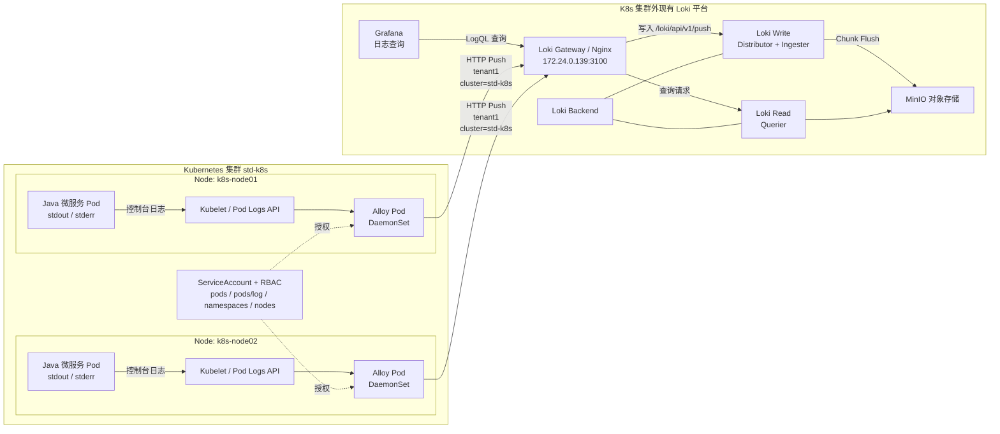
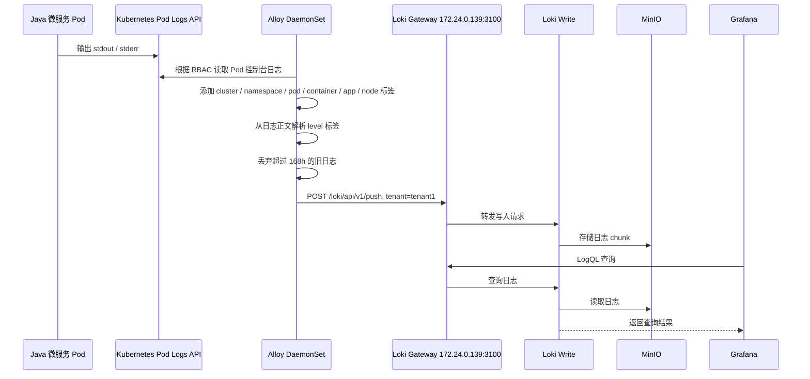

# K8s Alloy 采集 Pod 控制台日志执行步骤


## 1. 目标架构

K8s 集群内部署 Alloy DaemonSet，每个节点一个 Alloy Pod。Alloy 通过 Kubernetes API 采集本节点 Pod 的 stdout/stderr 控制台日志，然后推送到集群外现有 Loki Gateway。

```text
Java 微服务 Pod stdout/stderr
  -> K8s API / Pod logs
  -> Alloy DaemonSet
  -> http://172.24.0.139:3100/loki/api/v1/push
  -> Loki Write
  -> MinIO
  -> Grafana 查询
```

### 整体架构图



### 日志流向图



## 2. 部署前确认

确认 K8s 节点或 Pod 网络能访问你的 Loki Gateway：

```bash
kubectl run curl-test -n default --rm -it --image=curlimages/curl -- \
  curl -v http://172.24.0.139:3100/ready
```

如果 Loki Gateway 有防火墙或安全组，需要放通 K8s Pod 网段或 Node 网段到 `3100` 端口。

## 3. 当前 YAML 里的关键配置

当前 `k8s/alloy-k8s-loki-logs.yaml` 已经按本环境配置好：

```text
Loki Gateway: 172.24.0.139:3100
Loki push URL: http://172.24.0.139:3100/loki/api/v1/push
Tenant: tenant1
Cluster label: std-k8s
```

对应 Alloy 配置：

```alloy
loki.write "default" {
  endpoint {
    url       = "http://172.24.0.139:3100/loki/api/v1/push"
    tenant_id = "tenant1"
  }
}
```

集群标签配置：

```alloy
stage.static_labels {
  values = {
    cluster  = "std-k8s",
    platform = "kubernetes",
    agent    = "alloy",
  }
}
```

说明：

- `cluster="std-k8s"` 用来区分这批日志来自当前 K8s 集群。
- `tenant_id="tenant1"` 需要和 Grafana Loki 数据源里的 `X-Scope-OrgID` 保持一致。
- 如果未来接入多个 K8s 集群，可以给不同集群设置不同 `cluster` 标签，例如 `prod-k8s`、`test-k8s`。

## 4. 部署 Alloy

执行：

```bash
kubectl apply -f alloy-k8s-loki-logs.yaml
```

查看 DaemonSet：

```bash
kubectl -n monitoring get ds alloy
kubectl -n monitoring get pod -l app.kubernetes.io/name=alloy -o wide
```

每个 K8s 节点应该有一个 Alloy Pod。

## 5. 查看 Alloy 运行日志

```bash
kubectl -n monitoring logs -l app.kubernetes.io/name=alloy --tail=100 -f
```

如果配置正确，通常能看到 discovery、tail pod logs、push Loki 的相关日志。

## 6. 验证 Loki 是否收到日志

在 Grafana Explore 里选择 Loki 数据源，查询：

```logql
{cluster="std-k8s", platform="kubernetes"}
```

按命名空间查询：

```logql
{cluster="std-k8s", namespace="default"}
```

按 Java 微服务查询：

```logql
{cluster="std-k8s", app="your-java-service"}
```

按日志级别查询：

```logql
{cluster="std-k8s", level="ERROR"}
```

按命名空间、服务和日志级别组合查询：

```logql
{cluster="std-k8s", namespace="base-sit", app="tsingyun-uc", level="INFO"}
```

如果你的 Pod 没有 `app` 或 `app.kubernetes.io/name` 标签，可以先用：

```logql
{cluster="std-k8s"} |~ "关键字"
```

## 8. level 标签说明

K8s 采集的是 Pod 控制台输出，没有这种文件目录结构，所以 `level` 需要从日志正文里解析。当前 YAML 在 `loki.process "pod_logs"` 里配置了：

```alloy
stage.regex {
  expression         = "(?i)\\b(?P<level>TRACE|DEBUG|INFO|WARN|WARNING|ERROR|FATAL)\\b"
  labels_from_groups = true
}
```

只要 Java 控制台日志里出现以下关键字，就会生成对应的 Loki 标签：

```text
TRACE
DEBUG
INFO
WARN
WARNING
ERROR
FATAL
```

例如日志正文：

```text
2026-06-11 16:30:00.123 INFO  [tsingyun-uc] user login success
2026-06-11 16:31:00.456 ERROR [tsingyun-uc] call remote service failed
```

会被打上：

```text
level="INFO"
level="ERROR"
```

注意：`level` 标签只会对修改 Alloy 配置后新采集的日志生效，历史日志不会自动补标签。

## 9. app 标签说明

传统部署里，`app` 是从日志文件路径第一级目录提取的：

```alloy
rule {
  source_labels = ["__path__"]
  regex         = "/home/application/logs/([^/]+)/[^/]+/.*\\.log"
  target_label  = "app"
  replacement   = "$1"
}
```

K8s 采集 Pod 控制台日志时没有这种日志目录结构，所以当前配置改为从 Deployment 名称提取 `app` 标签。

Deployment 创建 Pod 的链路通常是：

```text
Deployment: tsingyun-uc
  -> ReplicaSet: tsingyun-uc-6dccfd4db
  -> Pod: tsingyun-uc-6dccfd4db-l2zsv
```

当前 Alloy 配置使用 Pod 的 controller 元数据，把 ReplicaSet 名里的最后一段 hash 去掉：

```alloy
rule {
  source_labels = ["__meta_kubernetes_pod_controller_kind", "__meta_kubernetes_pod_controller_name"]
  regex         = "ReplicaSet;(.+)-[a-f0-9]{8,10}"
  action        = "replace"
  target_label  = "app"
  separator     = ";"
  replacement   = "$1"
}
```

这样最终会得到：

```text
app="tsingyun-uc"
```

同时保留了 `workload` 标签，用于查看原始 controller 名称：

```text
workload="tsingyun-uc-6dccfd4db"
```

如果未来有非 Deployment 类型的工作负载，例如 StatefulSet 或 Job，可以按同样思路增加对应规则。

可选：仍然建议给 Java 微服务 Deployment 增加标准标签，方便 K8s 资源管理和其他监控系统识别：

```yaml
metadata:
  labels:
    app.kubernetes.io/name: order-service
    app.kubernetes.io/part-of: business-platform
spec:
  template:
    metadata:
      labels:
        app.kubernetes.io/name: order-service
        app.kubernetes.io/part-of: business-platform
```

这样 Grafana 查询会更稳定：

```logql
{cluster="std-k8s", namespace="prod", app="order-service"}
```

## 10. 排除不想采集的 Pod

当前 YAML 支持通过注解排除采集。给 Pod template 加：

```yaml
metadata:
  annotations:
    loki.grafana.com/scrape: "false"
```

例如某个 Deployment：

```yaml
spec:
  template:
    metadata:
      annotations:
        loki.grafana.com/scrape: "false"
```

## 11. 常见问题

### Alloy Pod 正常，但 Grafana 查不到日志

检查 Loki Gateway 地址是否从 K8s Pod 内可达：

```bash
kubectl run curl-test -n default --rm -it --image=curlimages/curl -- \
  curl -v http://172.24.0.139:3100/ready
```

检查租户是否一致。你的现有部署默认是：

```text
tenant1
```

Grafana 数据源也需要使用相同的 `X-Scope-OrgID`。

### 查询 app 标签为空

如果是 Deployment 创建的 Pod，正常情况下会通过 controller 元数据提取 `app`。如果 `app` 为空，先查看 Pod 的 ownerReferences：

```bash
kubectl -n <业务命名空间> get pod <业务Pod名> -o yaml | grep -A8 ownerReferences
```

如果 Pod 不是由 Deployment/ReplicaSet 创建，例如裸 Pod、Job、CronJob、StatefulSet，则需要针对对应工作负载类型补充 relabel 规则，或者给 Pod template 增加 `app.kubernetes.io/name` 标签后改用标签提取。

### 查询 level 标签为空

先确认 Alloy 配置已经重新应用并重启：

```bash
kubectl apply -f k8s/alloy-k8s-loki-logs.yaml
kubectl -n monitoring rollout restart ds/alloy
kubectl -n monitoring rollout status ds/alloy
```

然后确认 Java 控制台日志正文里确实包含 `INFO`、`WARN`、`ERROR` 等级别关键字：

```bash
kubectl -n <业务命名空间> logs <业务Pod名> --tail=20
```

如果日志正文里没有这些关键字，Alloy 无法凭空生成 `level` 标签，需要修改 Java 日志格式，让控制台输出包含日志级别。

还要注意：`level` 标签只对新采集的日志生效。Grafana 查询时先把时间范围选到最近 `5m` 或 `15m`，并让服务新输出几条日志。

### 日志重复

确认 Alloy 使用的是 DaemonSet，并且配置里有节点过滤：

```alloy
field = "spec.nodeName=" + sys.env("ALLOY_NODE_NAME")
```

这个配置会让每个 Alloy 只采集自己所在节点的 Pod 日志。

### Alloy 报 `/var/lib/alloy/data: permission denied`

这是因为 Alloy 容器默认不是 root 用户，不能写入该目录。当前 YAML 已经使用：

```text
--storage.path=/tmp/alloy/data
```

重新应用 YAML 并重启 DaemonSet 即可。

### Loki 返回 `timestamp too old`

如果 Alloy 日志里出现：

```text
server returned HTTP status 400 Bad Request
has timestamp too old
oldest acceptable timestamp is
```

说明 Alloy 采集到了 Pod 里较早的历史控制台日志，但 Loki 配置不接受这么旧的日志。当前 YAML 已经在 `loki.process "pod_logs"` 里增加：

```alloy
stage.drop {
  older_than          = "168h"
  drop_counter_reason = "older_than_loki_acceptance_window"
}
```

这样超过 168 小时的日志会在 Alloy 侧直接丢弃，不再发送到 Loki。

### 只想采集某些 namespace

可以在 `discovery.relabel "pod_logs"` 增加 drop 规则，例如排除系统命名空间：

```alloy
rule {
  source_labels = ["__meta_kubernetes_namespace"]
  regex         = "kube-system|monitoring"
  action        = "drop"
}
```

如果只采集 `prod` 命名空间：

```alloy
rule {
  source_labels = ["__meta_kubernetes_namespace"]
  regex         = "prod"
  action        = "keep"
}
```

## 12. 回滚

删除 Alloy：

```bash
kubectl delete -f k8s/alloy-k8s-loki-logs.yaml
```

这只会删除 K8s 里的 Alloy 采集组件，不会影响你集群外已有的 Loki、Grafana、MinIO。
